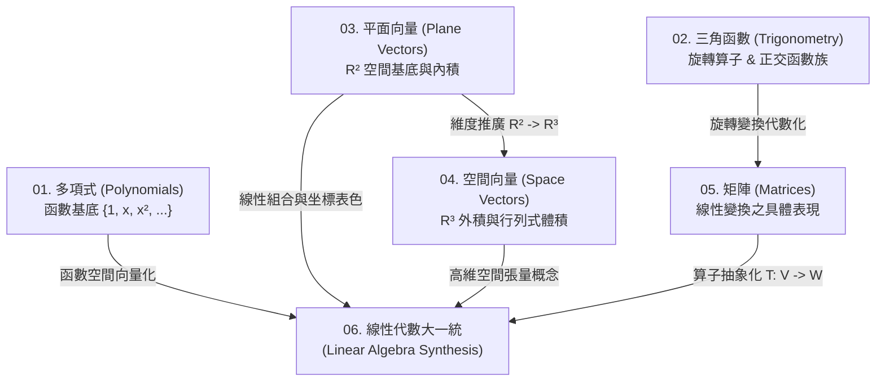

# LLM Wiki 知識庫總覽：高中數學與線性代數大一統知識庫

> **主題名稱**：從高中數學到線性代數的大一統之路（The Grand Unified Path: From High School Math to Linear Algebra）  
> **核心目標**：收錄高中（高一至高二）五大核心模組（多項式、三角函數、平面向量、空間向量、矩陣），並以現代「線性代數（Linear Algebra）」的公理化向量空間與線性變換視角進行全面整合與串接。  
> **建庫方式**：採用「先討論、後生成」機制，經過主題確認、多源資料 Ingest 與語意實體萃取後編纂成庫。

---

## 知識節點目錄（Ingested Sources）

1. [01. 多項式代數與函數結構 (Polynomials)](01_polynomials.md)
   - 核心概念：除法原理、因式與餘式定理、拉格朗日插值、多項式作為向量空間（$P_n$）、Taylor 展開萌芽。
2. [02. 三角函數與幾何代數統一 (Trigonometric Functions)](02_trigonometry.md)
   - 核心概念：廣義角與單位圓、加法定理、旋轉本質、正交函數族、尤拉公式之萌芽。
3. [03. 平面向量與基底幾何 (Plane Vectors in $\mathbb{R}^2$)](03_plane_vectors.md)
   - 核心概念：有向線段、線性組合（Linear Combination）、基底（Basis）、純量積（內積）、柯西不等式與正射影。
4. [04. 空間向量與維度提升 (Space Vectors in $\mathbb{R}^3$)](04_space_vectors.md)
   - 核心概念：三維空間坐標、外積（Cross Product）之幾何與代數定義、純量三重積、三階行列式與平行六面體體積。
5. [05. 矩陣與線性映射 (Matrices and Linear Transformations)](05_matrices.md)
   - 核心概念：二元與三元一次方程組、增廣矩陣、列運算、二階矩陣的幾何變換（旋轉、伸縮、推移、鏡射）、馬可夫轉移矩陣。
6. [06. 終極串聯：線性代數的大一統視角 (The Grand Linear Algebra Synthesis)](06_linear_algebra_synthesis.md)
   - 核心串接：
     - **向量空間（Vector Space）的抽象昇華**：箭頭 vs 多項式 vs 函數（$C[a, b]$ 上的基底）。
     - **線性映射（Linear Map）**：矩陣如何作為線性算子的坐標代表。
     - **幾何與代數的統一**：三角函數加法定理即為旋轉矩陣乘法；空間外積與反對稱張量；多項式插值與 Vandermonde 矩陣。

---

## 概念關聯圖（Knowledge Graph）

---
*知識庫生成時間：2026-11-21 | 驗證狀態：已通過交叉檢驗（Cross-Verified）*
