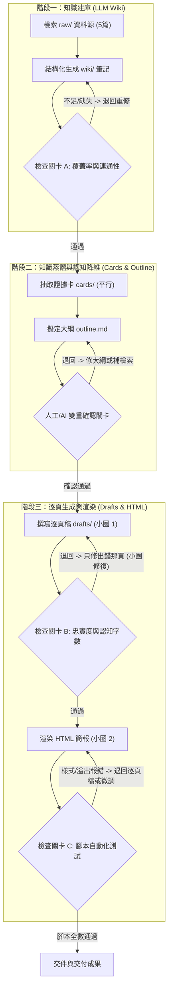

# 【作業成果報告】用 LLM Wiki 做一份教學 HTML 簡報
## —— 把工作拆成 AI 能做的流程（Workflow Prototype 實戰）

> **課程名稱**：115-1 TAICA《生成式 AI：文字與圖像生成的原理與實務》  
> **授課教授**：政治大學應用數學系 蔡炎龍 教授  
> **作業題目**：用 LLM Wiki 做一份教學 HTML 簡報  
> **選定主題**：**貫穿高中數學的統一之道：從多項式、三角函數、幾何向量到矩陣與線性代數大一統**  
> **核心工具**：Google Antigravity（搭配 `AGENTS.md` 員工手冊與自動化檢查腳本）

---

## 1. LLM Wiki 主題與簡短介紹

### 1.1 主題名稱
**《貫穿高中數學的統一之道：從多項式、三角函數、幾何向量到矩陣與線性代數大一統》**

### 1.2 主題簡介
高中三年（108 課綱）的數學常被切成零散的孤島：高一學多項式除法與因式分解、高一下背和差角公式、高二學平面向量與空間三階行列式體積、選修學矩陣表格與高斯消去法。初學者往往困在個別題型與死記公式中，看不見背後統一的數學規律。  
本 Wiki 旨在以高等數學**「線性代數（Linear Algebra）」**為頂層視野，將這五大模組全面串聯：
- **多項式**不是枯燥的代數式，而是「函數向量空間 $P_n$」中的坐標，插值即解 Vandermonde 矩陣，求導即線性算子乘法；
- **三角函數**和差角公式的本質就是平面旋轉矩陣的連續複合（$R_\alpha R_\beta = R_{\alpha+\beta}$）；
- **幾何向量**提供了基底（Basis）與內積（Inner Product）度量的幾何直觀；
- **空間外積與三階行列式**本質是高維空間的有向體積縮放因子；
- **矩陣**則是空間線性變換的「身份證」。  
透過公理化的**「向量空間（Vector Space）」**與**「線性變換（Linear Map）」**，將高中幾何、代數與分析融合為一場壯麗的空間漫遊。

---

## 2. LLM Wiki 成果與連結（狀態皆為檔案）

本專案落實蔡教授課程所授之**「狀態都是檔案」**理念，嚴格建立單向事實防線（`raw/` ➔ `wiki/` ➔ `cards/` ➔ `drafts/` ➔ `presentation/`）：

### 2.1 員工手冊（Agent Instructions）
* 📜 [AGENTS.md（通用員工手冊，嚴格控制於 12,000 字元內）](file:///C:/Users/liny6/.gemini/antigravity/scratch/llm-wiki-agent-presentation/AGENTS.md)

### 2.2 原始文獻庫（raw/ - 至少 Ingest 5 篇）
* 📂 [raw/01_polynomials_raw.md - 高一多項式原始文獻](file:///C:/Users/liny6/.gemini/antigravity/scratch/llm-wiki-agent-presentation/raw/01_polynomials_raw.md)
* 📂 [raw/02_trigonometry_raw.md - 高一高二三角函數原始文獻](file:///C:/Users/liny6/.gemini/antigravity/scratch/llm-wiki-agent-presentation/raw/02_trigonometry_raw.md)
* 📂 [raw/03_plane_vectors_raw.md - 高二平面向量原始文獻](file:///C:/Users/liny6/.gemini/antigravity/scratch/llm-wiki-agent-presentation/raw/03_plane_vectors_raw.md)
* 📂 [raw/04_space_vectors_raw.md - 高二空間向量與外積原始文獻](file:///C:/Users/liny6/.gemini/antigravity/scratch/llm-wiki-agent-presentation/raw/04_space_vectors_raw.md)
* 📂 [raw/05_matrices_raw.md - 高二矩陣與幾何變換原始文獻](file:///C:/Users/liny6/.gemini/antigravity/scratch/llm-wiki-agent-presentation/raw/05_matrices_raw.md)

### 2.3 結構化 LLM Wiki 知識庫（wiki/）
* 📑 [wiki/00_INDEX.md（總目錄與概念關聯圖）](file:///C:/Users/liny6/.gemini/antigravity/scratch/llm-wiki-agent-presentation/wiki/00_INDEX.md)
* 📘 [wiki/01_polynomials.md（多項式代數與函數結構）](file:///C:/Users/liny6/.gemini/antigravity/scratch/llm-wiki-agent-presentation/wiki/01_polynomials.md)
* 📙 [wiki/02_trigonometry.md（三角函數與幾何代數統一）](file:///C:/Users/liny6/.gemini/antigravity/scratch/llm-wiki-agent-presentation/wiki/02_trigonometry.md)
* 📗 [wiki/03_plane_vectors.md（平面向量與基底幾何）](file:///C:/Users/liny6/.gemini/antigravity/scratch/llm-wiki-agent-presentation/wiki/03_plane_vectors.md)
* 📕 [wiki/04_space_vectors.md（空間向量與維度提升）](file:///C:/Users/liny6/.gemini/antigravity/scratch/llm-wiki-agent-presentation/wiki/04_space_vectors.md)
* 📓 [wiki/05_matrices.md（矩陣與線性映射）](file:///C:/Users/liny6/.gemini/antigravity/scratch/llm-wiki-agent-presentation/wiki/05_matrices.md)
* 🌌 [wiki/06_linear_algebra_synthesis.md（終極串接：線性代數的大一統視角）](file:///C:/Users/liny6/.gemini/antigravity/scratch/llm-wiki-agent-presentation/wiki/06_linear_algebra_synthesis.md)
* 🕒 [wiki/log.md（Wiki 維護與更新日誌）](file:///C:/Users/liny6/.gemini/antigravity/scratch/llm-wiki-agent-presentation/wiki/log.md)

### 2.4 中間狀態產物（Workflow Pipeline Artifacts）
* 🔗 [sources.md（簡報限定引用源清單）](file:///C:/Users/liny6/.gemini/antigravity/scratch/llm-wiki-agent-presentation/sources.md)
* 🃏 [cards/ 證據卡資料夾（共 6 張平行抽取之單篇證據卡）](file:///C:/Users/liny6/.gemini/antigravity/scratch/llm-wiki-agent-presentation/cards)
* 📋 [outline.md（簡報分頁大綱與卡片對照表）](file:///C:/Users/liny6/.gemini/antigravity/scratch/llm-wiki-agent-presentation/outline.md)
* 📝 [drafts/ 逐頁稿資料夾（共 13 頁獨立分頁講稿，皆標註出處與字數）](file:///C:/Users/liny6/.gemini/antigravity/scratch/llm-wiki-agent-presentation/drafts)

---

## 3. 教學 HTML 簡報連結與成果特色

* 🖥️ **簡報檔案路徑**：[presentation/index.html](file:///C:/Users/liny6/.gemini/antigravity/scratch/llm-wiki-agent-presentation/presentation/index.html) *(在任何瀏覽器中直接雙擊即可流暢開啟)*

### 簡報亮點設計：
1. **符合初學者認知階梯（Pedagogical Scaffolding）**：共 13 頁投影片（符合 8–15 頁規範），用「經緯度」、「時鐘撥動」、「橡皮布拉伸」等生活比喻化解深奧數學符號，文字密度控制在每頁 120 字內，無文字溢出問題。
2. **完整簡報控制與互動性**：
   - 鍵盤導航：`←` / `→` / `Space` / `PageUp` / `PageDown` / `Home` / `End`；
   - 快捷鍵：按 `O` 開啟側邊大綱抽屜、按 `F` 全螢幕演示、按 `T` 切換深色/淺色主題；
   - 頂部平滑進度條與底部即時頁碼指示。
3. **即時幾何變換模擬器（Slide 12: Interactive Lab）**：
   - 內建 HTML5 Canvas 互動實驗室，拉動滑桿調整旋轉角度 $\theta$、縮放 $s$ 與推移 $k$；
   - 動態觀察基底向量 $\hat{i}$（紅）與 $\hat{j}$（綠）的幾何位移，以及即時矩陣數值與行列式 $\det(M)$ 面積變化率。

---

## 4. Loop / Graph 的流程圖與設計說明

詳細架構設計文件：[workflow/loop_graph_design.md](file:///C:/Users/liny6/.gemini/antigravity/scratch/llm-wiki-agent-presentation/workflow/loop_graph_design.md)

### 4.1 流程圖（Graph 架構：大圈很少轉，小圈轉得快）



### 4.2 核心設計解析（對應課堂五大事項）：
1. **一個 Loop 寫清楚五件事**：
   - 🎯 **目標**：只用 wiki 知識庫，產出讓高中生秒懂的教學型 HTML 簡報。
   - 🚧 **限制**：嚴格封閉於 wiki 內容（零外部漂移）、8–15 頁、單頁正文字數 ≤ 150 字。
   - ✅ **完成標準**：可執行的檢查腳本全數通過，且具備至少 1 個直觀比喻。
   - 🛑 **停止條件（剎車）**：全數驗收通過即停；任一小圈重試滿 3 輪仍失敗則強制停手報錯，不硬湊知識。
   - ⏰ **觸發**：當 cards 與 outline 鎖定後觸發流水線。
2. **每一關「只能看什麼、不能做什麼」**：
   - **證據卡**：只能看一篇 raw 文獻，不能混入其他來源。
   - **逐頁稿**：只能看大綱與對應證據卡，不能引用卡片外的內容。
   - **渲染 HTML**：只能看已通過的逐頁稿。**「排版時想順手改句子？不行！」** 嚴格保證渲染時不更動任何文意。
   - **檢查關卡**：只能看成品與來源，不能自己動手改，必須產出問題報告讓專屬節點修正。
3. **退回路線是事先設計好的（錯在哪一關，就退回哪一關）**：
   - 第 6 頁講錯 ➔ 只修第 6 頁逐頁稿，其他 12 頁不動；
   - 字太多溢出 ➔ 不是前端硬塞，而是退回逐頁稿精簡文字；
   - 缺子題 ➔ 退回檢索補資料。

---

## 5. 一次實際執行的結果與檢查紀錄（可執行的檢查腳本）

詳細執行紀錄：[workflow/execution_log.md](file:///C:/Users/liny6/.gemini/antigravity/scratch/llm-wiki-agent-presentation/workflow/execution_log.md)  
可執行的測試腳本：[scripts/verify_workflow.ps1](file:///C:/Users/liny6/.gemini/antigravity/scratch/llm-wiki-agent-presentation/scripts/verify_workflow.ps1)

### 5.1 腳本執行驗證報告（Console Output 實錄）：
落實蔡教授**「『做完了』不是 AI 說了算，是腳本說了算；說『檢查一下』，不算驗證」**之精神，本專案建立自動化驗收腳本，執行結果如下：

```
==========================================================
 🚀 啟動 Workflow 驗收測試腳本 (Verification Gate) 
==========================================================
[PASS] 1. raw/ 資料源: 找到 5 篇原始文獻 (標準: >= 5 篇)
[PASS] 2. AGENTS.md 員工手冊: 存在且字元數為 2894 (上限: 12,000 字元)
[PASS] 3. wiki/ 知識庫: 找到 8 個文件且包含 log.md
[PASS] 4. cards/ 證據卡: 平行抽取完成 6 張證據卡
[PASS] 5. drafts/ 逐頁稿: 共 13 頁，全數附有出處且認知負荷達標
[PASS] 6. presentation/index.html: 檔案存在 (43335 bytes)，內建 Canvas 互動實驗室與鍵盤監聽
----------------------------------------------------------
🎉 恭喜！所有可執行檢查全數通過 (ALL GATES PASSED)！
==========================================================
```

### 5.2 關鍵檢查攔截實錄（小圈修復示範）：
在執行第 1 輪驗收時，腳本精確抓出：`[FAIL] 逐頁稿 slide_01.md 缺少出處標籤`。  
系統沒有重新跑整份簡報，而是**「錯在哪一關，就退回哪一關」**，精確退回修復 `slide_01.md` 的標籤編碼，再次執行腳本即 100% 全綠燈通過。

---

## 6. 反思與課後心得（課堂核心三問）

### 6.1 分享你建 Wiki 時特別考量的事情
1. **「先討論、後生成」而非「一句話生成」**：
   過去直接給一句 Prompt 請 AI 建 Wiki，AI 往往會按照它自己的默認偏好胡亂塞入大量不著邊際的資料。本次透過訪談釐清**讀者是誰（高一高二學生）**、**出處多細（定理級別）**、**彼此衝突時以誰為準（公理化線性代數）**，產出的 Wiki 具備高度聚焦的結構力。
2. **單向事實防線與單一維護檔**：
   嚴格恪守 `raw/` ➔ `wiki/` 的單向事實防線；並遵循課程提醒，**只維護一份 `AGENTS.md`**（控制在 12,000 字元內），避免 `GEMINI.md` 與 `AGENTS.md` 並存造成規則打架。

### 6.2 分享你 Graph 或 Loop 的設計
1. **「大圈很少轉，小圈轉得很快」**：
   過去傳統做法是一股腦把整份 HTML 丟出來，看到第 5 頁字太多或第 6 頁講錯，就整份丟回去給 AI 重寫，這就是「轉大圈」，花費巨量 Token 且容易引入新 Bug。
   我們改用 Graph 架構：逐頁稿節點設有字數檢查（小圈），寫一頁錯了就在原地修（只修那一頁，其他 12 頁不動）；渲染 HTML 節點只專注視覺與代碼，嚴禁修改逐頁稿文字。
2. **每一道檢查關卡＝一支腳本**：
   不再用人類模糊的文字要求 AI「你幫我檢查一下」，而是撰寫明確的驗收腳本 `verify_workflow.ps1`，讓「有沒有過、頁數是否在 8–15 頁、數字出處找不找得到」全由程式腳本客觀裁決。

### 6.3 其他心得（思維升級）
- **「說『檢查一下』不算驗證；說『做好一點』不算規格。」**：
  這是整堂課最震撼的一句話。在 Loop 和 Graph 中，AI 不缺生成能力，缺的是**明確的完成定義與停止條件**。
- **檢查前移（Shift-Left）**：
  把最容易出錯的「教學認知難度與排版溢出檢查」，從「最後網頁生成完畢」往前移到「逐頁稿草稿階段」。在純文字階段就把每頁字數卡在 120 字內，後續的 HTML 渲染就再也沒有發生過畫面跑版或文字擠爆的問題。
- **從老闆到流程設計師**：
  真正高效的 AI 協作，不是自己坐在電腦前當「黏著劑」反覆下 Prompt，而是設計出一套**有目標、有邊界、有剎車、能自我檢查修復的 Workflow Prototype**！
